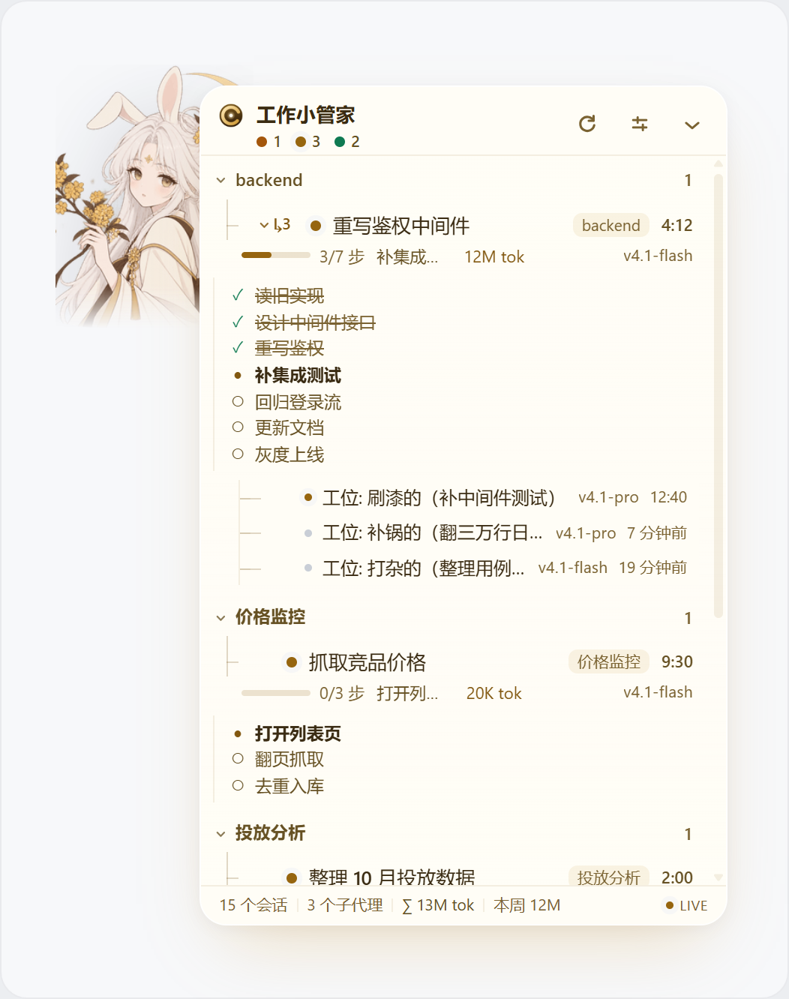
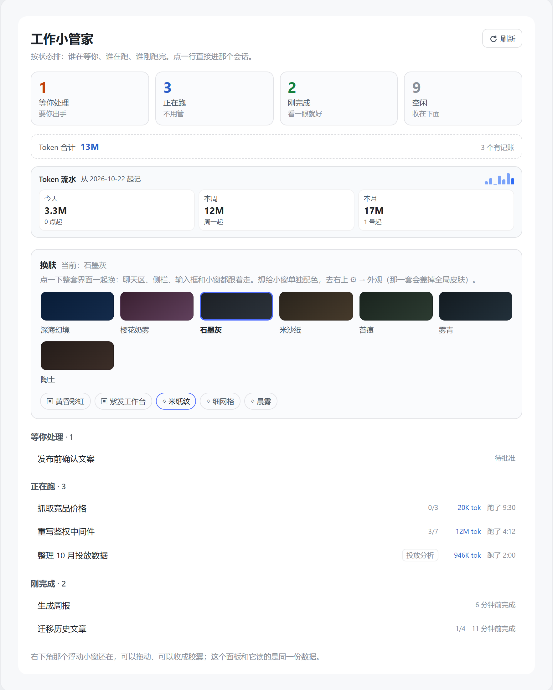

# 工作小管家 · Task Radar

DSH Web 插件：一个可以拖动、折叠的任务浮窗，以及主区工作面板。



## 功能

- 按工作区查看会话：等你处理、正在运行、刚完成、空闲。
- 查看待办清单、子代理、模型标签和 Token 用量，点击直达会话。
- 本地记录今天、本周、本月的 Token 增量，首次观察只建基线，不补算历史。
- 可选系统通知、浮窗外观和主题插画；首次安装默认「桂花月兔」。
- 边框粗细（0–3px）和颜色可调，默认跟随主题，可一键恢复。
- 框体大小拖右下角把手即可改（240–560 × 160–760），双击复位。
- 干扰控制：单条会话静音 1 小时、「我认这活做完了」收工、今天不再弹系统通知。
- 可选联动 `dsh-plugin-skin`；未安装时仍可独立使用任务监控与浮窗外观。



## 安装

本仓库是运行产物与验证源码组成的发布快照，入口已经可运行，无需构建。当前包版本以 `package.json` 为准。

在 DSH 的“插件 → 实验性插件 → 更多”中启用“自定义插件市场”，进入“发现 → 管理索引源”，添加：

```text
https://raw.githubusercontent.com/hualidan42-beep/dsh-plugin-task-radar/main/market-index.json
```

然后找到“工作小管家”点击安装。索引里的每个版本都指向 npm 上的精确版本号，并记录真实发布时间；这是作者自定义索引，不是 DSH 官方市场。

也可以直接装 npm 包：

```powershell
dsh plugin --profile <你的-profile> add "dsh-plugin-task-radar@0.10.0"
```

安装 bundle 后默认选中启用，是否刷新或重启以宿主提示为准。不需要手工建立 junction 或覆盖 profile 文件。

## 数据与权限

- 读取宿主已经下发的工作区、会话状态、待办、子代理和 Token 投影。
- 浮窗位置、外观设置、已读/计时记录、用量流水保存在当前浏览器的 `localStorage["dsh-plugin-task-radar/v1"]`。
- 不注册 Host 路由，不写入业务目录，不调用模型，不主动将会话数据上传到外部服务。
- 系统通知需要用户手动授权；通知中可能出现会话标题。
- 当前浏览器清除站点数据会清除插件记录；卸载插件不会自动删除这些浏览器数据。

## 已知限制

- 仅中文界面，面向 DSH Web；需要现代浏览器支持 relative color、color-mix 等 CSS。
- 尚未宣称特定 DSH 版本范围的兼容保证，也未在干净 profile 中完成安装验收。
- 父会话计时从本插件开始观察时算起；待办内容由代理维护，不保证结束时全部勾选。
- Token 流水不是账单：只记观察之后的增量，采用本地时区，保留最多 400 天；清缓存或更换浏览器不继承。
- 缺少宿主投影时，相关明细可能不显示。

## 验证

需要 Node.js >=18。仓库中的测试不需要浏览器或安装额外依赖：

```powershell
npm run verify
npm pack --dry-run --ignore-scripts
```

发布前最近一次结果为 250 项单元断言、164 项装配断言通过。单测/假 DOM 测试不替代真实 DSH 的浏览器安装验收。

## 更新记录

- **0.10.0**：边框粗细与颜色可调；框体大小可拖拽调整（双击复位）；新增静音 1 小时、会话收工、今日免打扰三种干扰控制。
- **0.7.1**：首次安装的默认外观改为「桂花月兔」（原先跟随宿主）；已经选过主题的用户不受影响。
- **0.7.0**：首个公开发布版本。

更新方法与发版流程见 [UPDATE.zh-CN.md](./UPDATE.zh-CN.md)。

## 分发边界与素材

本仓库只包含发布快照和两份无浏览器测试；不包含开发机工作区、业务数据、素材生成服务配置、原始图片或截图。图片已内嵌在 `client.js` 中。作者在此次发布准备中已确认当前内嵌素材可公开再分发；此声明不将第三方素材自动变为 MIT 授权。

包配置中的 MIT 声明针对作者有权授权的代码，第三方角色或素材的权利仍属于各自权利人。
